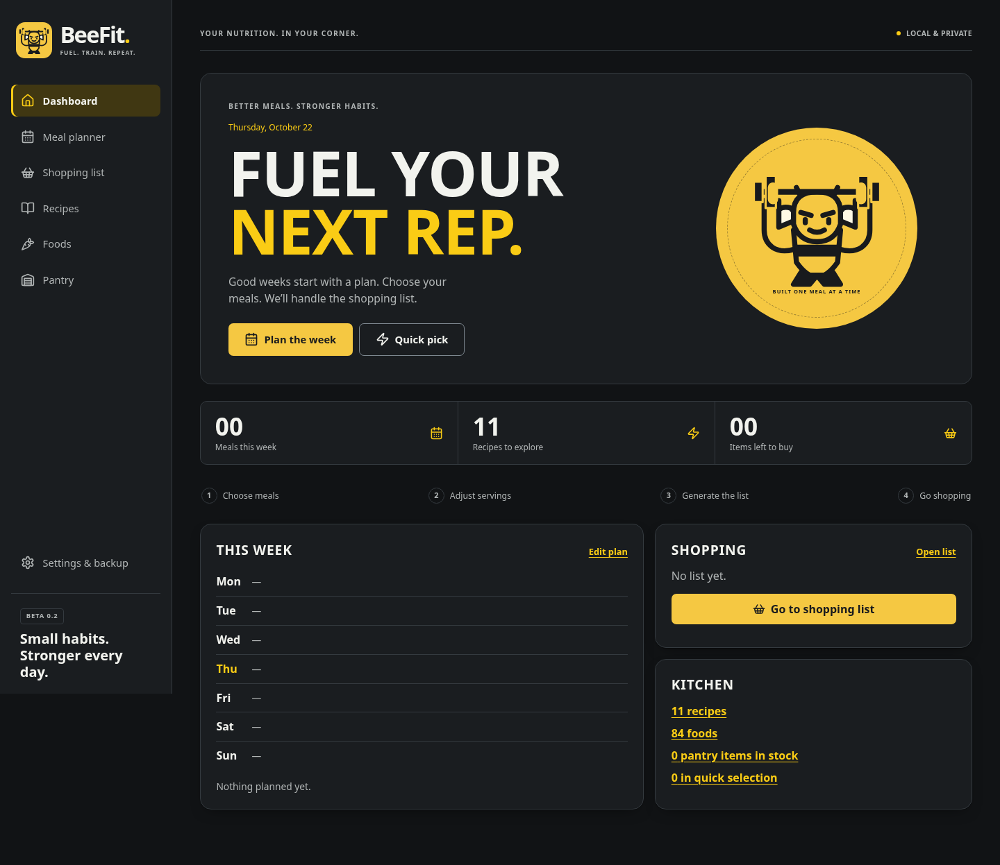
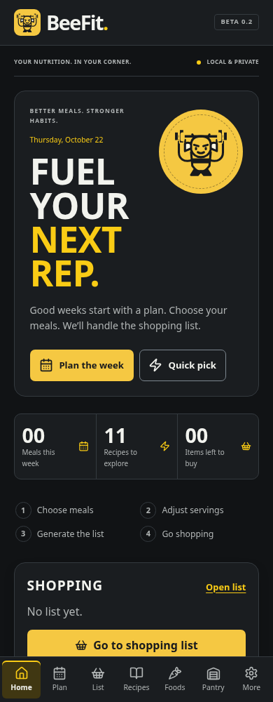

# BeeFit — yellow & charcoal

A single visual identity for the existing meal-planning app: warm yellow,
charcoal, readable type and a strong bee lifting a barbell. The dashboard's
message is “Fuel your next rep.” Its counters reflect the actual meal plan,
recipe collection and remaining shopping items.

## Design system

- Brand yellow: `#f5c842`; logo/brand ink: `#181a1d`.
- Dark canvas: `#111315`, with neutral charcoal surfaces and warm off-white text.
- Light mode: warm neutral backgrounds, white surfaces and darker accent text.
- Iron Hive's primary actions use yellow with dark text in either display mode.
  Links retain a darker gold in light mode so small text remains readable.
- A shared wordmark and updated vector mascot appear in the desktop sidebar and
  mobile header. The large dashboard mascot is decorative to avoid repeated
  screen-reader announcements.
- Typography uses Barlow Condensed for display headings and Atkinson Hyperlegible
  for body text, with system fallbacks when external Google Fonts are unavailable.
- Cards, controls, recipe tiles, dialogs, navigation, planner days and Settings
  share the same surfaces, spacing and corner treatment.

Dark mode is the presentation focus. Existing saved display preferences and
“Match device” remain respected; this change does not silently switch a user's
mode. Midnight Bulk, Clean Cut and Titanium retain their alternative accents,
while the bee mark and neutral shell remain consistent with BeeFit.

## Previews

These Chromium captures use the app's default starter data and system font
fallbacks. They do not contain user meal data.

[Standalone vector bee mark](branding/beefit-mark.svg). The canonical component is
[`BeeMark.tsx`](../src/components/BeeMark.tsx); the shared wordmark is
[`Brand.tsx`](../src/components/Brand.tsx).

## Scope and validation

This is a presentation update. Meal schema/version, data and recovery keys,
serialization, backup/recovery logic and existing editing/planning/grocery
operations are retained. There are no Firebase, profile or sharing changes.

The contrast tests also check the new primary-action and brand color pairs.
Sixteen responsive browser cases cover every page with all four presets in light
and dark mode at 390px and 1280px widths, checking visible branding, horizontal
overflow, runtime errors and unchanged stored data. The existing accessibility,
feature and recovery regression suites remain in place.

Validation passed: TypeScript, 172 unit tests, all 78 Chromium tests, the portable
production build, and the Pages production build with artifact verification.
The final browser run had no failures or skips. The build verifier checks that
only the three expected site files are publishable under `/BeeFit/`; these review
images and the standalone logo export are not copied into the deployed artifact.

GitHub CI results are separate from the completed local validation. No merge or
deployment is performed as part of the redesign.
